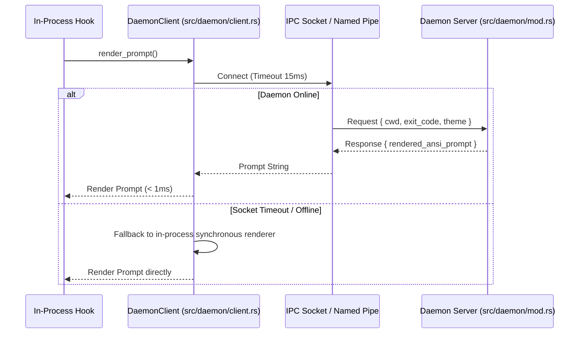

# ⚡ Daemon IPC Protocol & Asynchronous Cache

- **Primary Sources:**
  - Server: [`src/daemon/mod.rs`](file:///home/rihad/Developer/archive/creative-educational-code/gladeshell/src/daemon/mod.rs)
  - Client: [`src/daemon/client.rs`](file:///home/rihad/Developer/archive/creative-educational-code/gladeshell/src/daemon/client.rs)
- **Transport Layer:** Unix Domain Sockets (Linux/macOS) & Named Pipes (Windows)

---

## 1. 🎯 Architectural Role

In complex monorepos with hundreds of thousands of files, running git status checks can take 50ms–200ms. If executed synchronously inside the prompt rendering hook, the prompt would noticeably lag.

Gladeshell solves this with an optional background daemon:
1. The daemon watches the repository state asynchronously in a separate process.
2. When the user executes a command, the shell prompt asks the daemon for pre-calculated git and telemetry status over IPC.
3. The response arrives in `< 500µs`.
4. If the daemon is stopped, offline, or unresponsive, the client falls back to synchronous in-process rendering instantly with zero error messages.



---

## 2. 🔌 IPC Socket Specifications

### Linux / macOS: Unix Domain Sockets
- **Socket Path:** `/tmp/gladeshell-$UID.sock` (or `$XDG_RUNTIME_DIR/gladeshell.sock`).
- **File Permissions:** Restricted to `0600` (read/write only by the current user) to prevent local user snooping.

### Windows: Named Pipes
- **Pipe Path:** `\\.\pipe\gladeshell-$USERNAME`
- **Security Descriptor:** Configured with DACL granting full access only to the calling token.

---

## 3. 🧪 Robustness & Fail-Safe Architecture

The daemon client has a hard **15-millisecond socket timeout**. If a daemon thread deadlocks or crashes, the client will never hang the user's terminal:
```rust
let stream = match UnixStream::connect(&socket_path) {
    Ok(s) => s,
    Err(_) => return fallback_sync_render(ctx),
};
stream.set_read_timeout(Some(Duration::from_millis(15)))?;
```
