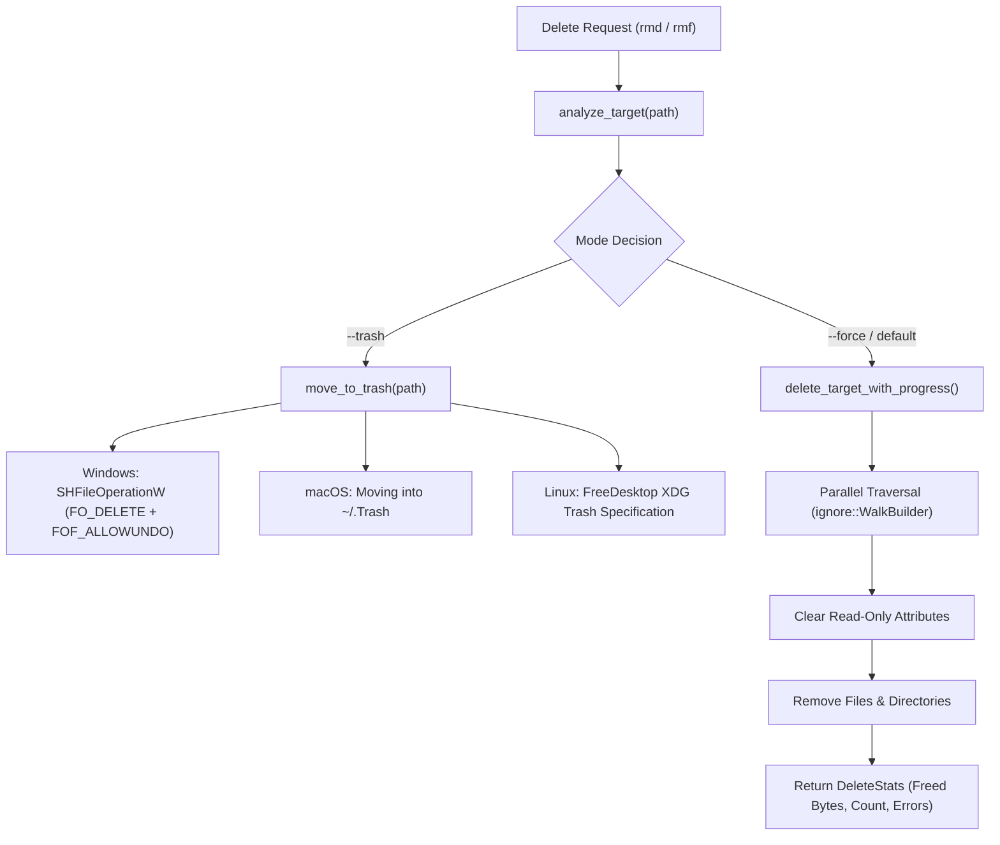

# 🛡️ System Engine Subsystem

- **Primary Source:** [`src/engines/system/delete.rs`](file:///home/rihad/Developer/archive/creative-educational-code/gladeshell/src/engines/system/delete.rs)
- **Facade Module:** [`src/engines/system/mod.rs`](file:///home/rihad/Developer/archive/creative-educational-code/gladeshell/src/engines/system/mod.rs)
- **Feature Gate:** `#[cfg(feature = "tools")]`
- **Architectural Domain:** Safe Cross-Platform File Deletion & Parallel Explorer

---

## 1. 🎯 Architectural Role

ACCIDENTAL FILE LOSS (`rm -rf *`) is one of the most critical hazards in command-line environments. The System Deletion Engine (`DeleteEngine`) serves as the bulletproof core for Gladeshell's modern `rmd` and `rmf` tools.

It provides:
1. **Recycle Bin / Trash Integration:** Moves files to the OS trash instead of permanently unlinking them.
2. **Parallel Ripgrep Traversal:** Multithreaded file search using `ignore::WalkBuilder` respecting `.gitignore`.
3. **Read-Only Auto-Unlocking:** Clears read-only flags on Windows and Unix before deletion to avoid permission denials.
4. **Real-Time Progress Callbacks:** Zero heap allocation progress reporter for interactive TUI progress bars.



---

## 2. 🌐 Native OS Trash Specifications

### Windows: `SHFileOperationW`
On Windows, Gladeshell interfaces directly with the native Win32 Shell API:
```rust
let mut sh_file_op = SHFILEOPSTRUCTW {
    hwnd: std::ptr::null_mut(),
    wFunc: FO_DELETE,
    pFrom: wide_path.as_ptr(),
    pTo: std::ptr::null(),
    fFlags: FOF_ALLOWUNDO | FOF_NOCONFIRMATION | FOF_SILENT,
    // ...
};
let res = unsafe { SHFileOperationW(&mut sh_file_op) };
```
This guarantees the file appears in the official Windows Recycle Bin with restore capability.

### macOS: `~/.Trash`
Gladeshell queries the user's home directory and safely moves the target into `~/.Trash`, appending a collision-resistant timestamp suffix if a file with the same name already exists.

### Linux: XDG Trash Specification
Gladeshell conforms to the **FreeDesktop.org Trash Specification**:
1. Creates metadata file in `$XDG_DATA_HOME/Trash/info/<name>.trashinfo`.
2. Stores original path and deletion timestamp.
3. Moves payload to `$XDG_DATA_HOME/Trash/files/<name>`.

---

## 3. ⚡ Bounded Ripgrep Parallel Search

In `src/engines/system/delete.rs`, the interactive search bar (`search_interactive_targets`) executes multithreaded directory scans:
- **Respects Git Ignore:** Bypasses `.git`, `node_modules`, and ignored paths automatically.
- **Atomic Cancellation Token (`Arc<AtomicBool>`):** Instantly terminates background worker threads when the user presses `Esc` or modifies the search query.
- **Bounded Buffer:** Limits result sets to `max_results` (default 500) to keep TUI memory consumption below 5MB.

---

## 4. 🛡️ Public Facade API

```rust
pub struct DeleteEngine;

impl DeleteEngine {
    pub fn analyze(path: &Path) -> Result<DeleteTarget, Box<dyn Error>>;
    
    pub fn delete<F>(
        target: &DeleteTarget,
        mode: DeleteMode,
        progress: F,
    ) -> Result<DeleteStats, Box<dyn Error>>
    where
        F: FnMut(u64, u64, &Path);

    pub fn trash(path: &Path) -> Result<(), Box<dyn Error>>;

    pub fn search(
        base_dir: &Path,
        pattern: &str,
        cancel_token: &Arc<AtomicBool>,
        max_results: usize,
    ) -> Vec<DeleteTarget>;
}
```
