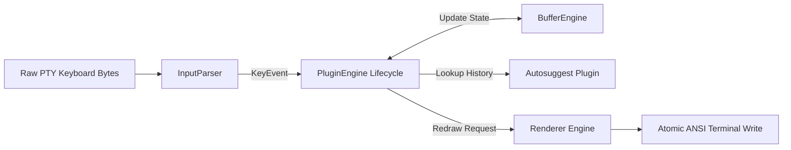

# 🖥️ Terminal Engine Subsystem

- **Primary Sources:**
  - [`src/engines/terminal/buffer.rs`](file:///home/rihad/Developer/archive/creative-educational-code/gladeshell/src/engines/terminal/buffer.rs)
  - [`src/engines/terminal/parser.rs`](file:///home/rihad/Developer/archive/creative-educational-code/gladeshell/src/engines/terminal/parser.rs)
  - [`src/engines/terminal/renderer.rs`](file:///home/rihad/Developer/archive/creative-educational-code/gladeshell/src/engines/terminal/renderer.rs)
  - [`src/engines/terminal/plugin.rs`](file:///home/rihad/Developer/archive/creative-educational-code/gladeshell/src/engines/terminal/plugin.rs)
- **Architectural Domain:** Interactive Terminal Runtime & Redraw Loop

---

## 1. 🎯 Architectural Role

The Terminal Engine provides an interactive line-editor environment directly inside Gladeshell. It handles raw keyboard input events, maintains active cursor coordinates across complex Unicode and emoji graphemes, renders flicker-free double-buffered screen updates, and powers real-time autosuggestion and tab-completion plugins.



---

## 2. 🧩 Subsystem Components

### A. BufferEngine (`buffer.rs`)
The `BufferEngine` is an in-memory cursor state machine and line buffer.
- **Unicode Grapheme Indexing:** Avoids raw byte slicing. Mapping between cursor column position and UTF-8 bytes uses `.char_indices()`.
- **Flood Protection Guard (`MAX_BUFFER_LEN = 8192`):** Prevents memory exhaustion if malicious or runaway terminal input sends megabytes of characters to the PTY.
- **CJK & Wide-Char Handling:** Full compliance with Unicode East Asian Width standards. Wide characters and emojis advance cursor coordinates by 2 cells instead of 1.

### B. InputParser (`parser.rs`)
A non-blocking unified parser for terminal input escape sequences.
- **VT100 & ANSI CSI Parser:** Parses 1-byte control characters (`\r`, `\n`, `\t`, `\x7f`), 2-byte escape sequences (`\x1b[`), and 3-to-6 byte sequences (`CSI`, `SS3`).
- **KeyModifiers Recognition:** Accurately decodes `Shift+Tab` (`\x1b[Z`), `Ctrl+Left/Right` (`\x1b[1;5D`), and Home/End sequences (`\x1b[H`, `\x1b[F`, `\x1b[1~`).
- **Lookahead & Safe Malformed Recovery:** Discards invalid or incomplete ANSI sequences without entering infinite loops.

### C. Renderer (`renderer.rs`)
An atomic double-buffered screen refresh engine.
- **Zero-Flicker Redraw Sequence:**
  1. `\x1b[G` — Reposition cursor to column 1.
  2. `\x1b[K` — Clear current line from cursor to end of screen.
  3. `prompt_prefix` — Render prompt string.
  4. Typed command buffer with ANSI syntax highlighting.
  5. Ghost text suggestion (dimmed gray, rendered only when cursor is at EOL).
  6. `\x1b[0m` — Reset color formatting.
- **Ghost Text Guard (`MAX_GHOST_LEN = 512`):** Truncates runaway autosuggestions to prevent terminal flooding.

### D. PluginEngine (`plugin.rs`)
Orchestrates the interactive terminal event loop:
- **25ms Suggestion Timeout Guard:** Asynchronous autosuggestion lookups that exceed 25ms are aborted to keep interactive typing smooth at 60 FPS.
- **Key Interceptors:** Intercepts `Ctrl+A` (Home), `Ctrl+E` (End), `Ctrl+C` (Clear), `Tab` (Autocomplete), and Right Arrow (Accept Suggestion).

---

## 3. 🧪 Verification & Test Suite

The terminal engine is verified with 57 unit tests covering edge cases:
```bash
cargo test engines::terminal::
```
Key tests verified:
- `test_unicode_emoji_insert_and_backspace`
- `test_cursor_column_cjk_wide_chars`
- `test_backspace_clears_stale_ghost_text`
- `test_no_infinite_loop_on_bad_bytes`
