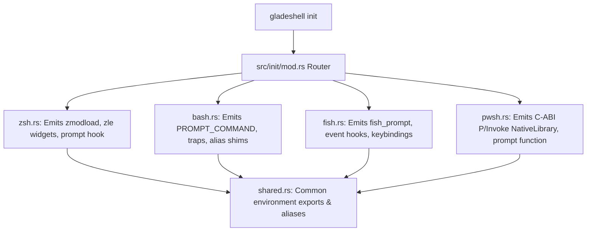

# 🐚 Shell Initialization & Integration Generators

- **Primary Sources:**
  - Coordinator: [`src/init/mod.rs`](file:///home/rihad/Developer/archive/creative-educational-code/gladeshell/src/init/mod.rs) (118 LoC)
  - Shared Shell Core: [`src/init/shared.rs`](file:///home/rihad/Developer/archive/creative-educational-code/gladeshell/src/init/shared.rs) (1,165 LoC)
  - Zsh Generator: [`src/init/zsh.rs`](file:///home/rihad/Developer/archive/creative-educational-code/gladeshell/src/init/zsh.rs) (387 LoC)
  - Bash Generator: [`src/init/bash.rs`](file:///home/rihad/Developer/archive/creative-educational-code/gladeshell/src/init/bash.rs) (136 LoC)
  - Fish Generator: [`src/init/fish.rs`](file:///home/rihad/Developer/archive/creative-educational-code/gladeshell/src/init/fish.rs) (154 LoC)
  - PowerShell Generator: [`src/init/pwsh.rs`](file:///home/rihad/Developer/archive/creative-educational-code/gladeshell/src/init/pwsh.rs) (217 LoC)
  - Config Cleaner: [`src/init/cleaner.rs`](file:///home/rihad/Developer/archive/creative-educational-code/gladeshell/src/init/cleaner.rs) (453 LoC)
- **Total Code:** 2,630 lines of Rust shell generation logic

---

## 1. 🎯 Architectural Role

When a developer runs `eval "$(gladeshell init zsh)"` or adds `gladeshell init pwsh | Invoke-Expression` to their profile, Gladeshell dynamically synthesizes complete shell integration scripts.

Unlike static scripts, Gladeshell's generators:
1. Detect whether the terminal supports TrueColor (`COLORTERM=truecolor`).
2. Verify dynamic loader availability (`zmodload` vs fallback).
3. Inject native keybindings (such as `Ctrl+R` for history, `Right Arrow` for autosuggestions).
4. Configure post-command hooks (`precmd`, `PROMPT_COMMAND`, `fish_prompt`, `prompt`).

---

## 2. 🧩 Shell Subsystem Breakdown

### A. Shared Shell Logic (`shared.rs` - 1,165 LoC)
Generates cross-shell environment setup, PATH precedence, default environment variables (`EDITOR`, `PAGER`, `VISUAL`), and wrapper functions for native Gladeshell tools (`rmd`, `rmf`, `gw`, `project`, `vault`).

### B. Zsh Integration (`zsh.rs` - 387 LoC)
- **ZLE Widgets:** Hooks into Zsh Line Editor (ZLE) for interactive autosuggestions (`autosuggest-accept`, `autosuggest-execute`).
- **Prompt Substitution:** Enables `setopt prompt_subst` and wires `precmd` to the C-ABI memory renderer.

### C. Bash Integration (`bash.rs` - 136 LoC)
- **PROMPT_COMMAND Array:** Appends prompt rendering to `PROMPT_COMMAND` array cleanly without overwriting existing user hooks.
- **Execution Timer:** Captures sub-second microsecond timestamps before and after command execution using `$EPOCHREALTIME` or `DEBUG` traps.

### D. Fish Integration (`fish.rs` - 154 LoC)
- Implements `fish_prompt`, `fish_right_prompt`, and `fish_mode_prompt`.
- Connects fish event listeners (`--on-event fish_postexec`) to record duration and status codes.

### E. PowerShell Integration (`pwsh.rs` - 217 LoC)
- Emits in-process P/Invoke definitions using `.NET` `System.Runtime.InteropServices`.
- Connects directly to `gladeshell_core.dll` without spawning subprocesses on Windows.

### F. Configuration Cleaner (`cleaner.rs` - 453 LoC)
- Used during `gladeshell self-uninstall` or repair.
- Safely scans `.zshrc`, `.bashrc`, `config.fish`, and PowerShell `$PROFILE`.
- Strips Gladeshell hook blocks idempotently without damaging user custom aliases.
