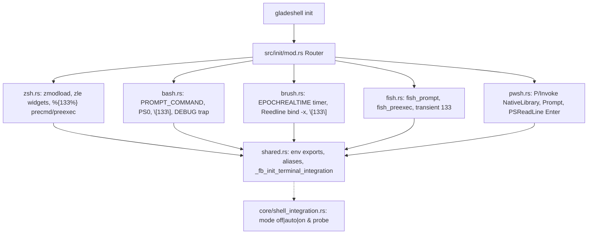

# 🐚 Shell Initialization & Integration Generators

- **Primary Sources:**
  - Coordinator: [`src/init/mod.rs`](file:///home/rihad/Developer/archive/creative-educational-code/gladeshell/src/init/mod.rs) (120 LoC)
  - Shared Shell Core: [`src/init/shared.rs`](file:///home/rihad/Developer/archive/creative-educational-code/gladeshell/src/init/shared.rs) (1,522 LoC)
  - Zsh Generator: [`src/init/zsh.rs`](file:///home/rihad/Developer/archive/creative-educational-code/gladeshell/src/init/zsh.rs) (437 LoC)
  - Bash Generator: [`src/init/bash.rs`](file:///home/rihad/Developer/archive/creative-educational-code/gladeshell/src/init/bash.rs) (189 LoC)
  - Brush Generator: [`src/init/brush.rs`](file:///home/rihad/Developer/archive/creative-educational-code/gladeshell/src/init/brush.rs) (237 LoC)
  - Fish Generator: [`src/init/fish.rs`](file:///home/rihad/Developer/archive/creative-educational-code/gladeshell/src/init/fish.rs) (209 LoC)
  - PowerShell Generator: [`src/init/pwsh.rs`](file:///home/rihad/Developer/archive/creative-educational-code/gladeshell/src/init/pwsh.rs) (253 LoC)
  - Config Cleaner & Setup: [`src/init/cleaner.rs`](file:///home/rihad/Developer/archive/creative-educational-code/gladeshell/src/init/cleaner.rs) (738 LoC)
  - Terminal Shell Integration Probe & Config: [`src/core/shell_integration.rs`](file:///home/rihad/Developer/archive/creative-educational-code/gladeshell/src/core/shell_integration.rs) (425 LoC)
- **Total Code:** 3,705 lines in `src/init/` (4,130 lines including `core/shell_integration.rs`)

---

## 1. 🎯 Architectural Role

When a developer runs `eval "$(gladeshell init zsh)"`, `eval "$(gladeshell init brush)"`, or `gladeshell init pwsh | Invoke-Expression`, Gladeshell dynamically synthesizes complete shell integration scripts.

Unlike static scripts, Gladeshell's generators:
1. Detect whether the terminal supports TrueColor (`COLORTERM=truecolor`) and emit per-session `OSC 133` / `OSC 7` / `OSC 777/99` hooks when enabled (`gladeshell integration auto|on`).
2. Verify dynamic loader availability (`zmodload` vs fallback).
3. Inject native keybindings (such as `Ctrl+R` for history, `Alt+C` for directory jump, `Right Arrow` for autosuggestions).
4. Configure pre/post-command hooks (`precmd`/`preexec`, `PROMPT_COMMAND`/`PS0`/`DEBUG` trap, `fish_prompt`/`fish_preexec`, PowerShell `Prompt`/PSReadLine `Enter` handler).

---

## 2. 🧩 Shell Subsystem Breakdown

### A. Shared Shell Logic (`shared.rs` - 1,522 LoC)
Generates cross-shell environment setup, PATH precedence, default environment variables (`EDITOR`, `PAGER`, `VISUAL`), wrapper functions for native Gladeshell tools (`rmd`, `rmf`, `gw`, `project`, `vault`), and `render_terminal_integration_helpers()` (`_fb_init_terminal_integration`, `_fb_emit_osc7`, `_fb_notify`).

### B. Zsh Integration (`zsh.rs` - 437 LoC)
- **ZLE Widgets:** Hooks into Zsh Line Editor (ZLE) for interactive autosuggestions (`autosuggest-accept`, `autosuggest-execute`).
- **Prompt & Semantic Markers:** Enables `setopt prompt_subst`, wires `_fb_precmd` / `_fb_preexec`, wraps `OSC 133;A/B` in `%{...%}`, and frames transient prompts.

### C. Bash Integration (`bash.rs` - 189 LoC)
- **PROMPT_COMMAND Array:** Appends prompt rendering to `PROMPT_COMMAND` cleanly without overwriting existing user hooks.
- **Execution & OSC Hooks:** Captures timestamps via `$EPOCHREALTIME` / `DEBUG` trap, wraps `OSC 133;A/B` in `\[...\]`, and uses `PS0` for `OSC 133;C`.

### D. Brush Integration (`brush.rs` - 237 LoC)
- **Reedline Keybindings & History:** Uses `bind -x` widgets (`Ctrl+R`, `Alt+C`) with `READLINE_LINE`, explicit `~/.brush_history` `HISTFILE`, and POSIX function adapters for operator aliases (`rel`, `brushrc`, `path`).
- **Semantic Prompts:** Tracks command execution via `$EPOCHREALTIME` + `HISTCMD` guard for empty `<Enter>` transitions alongside `OSC 133` / `OSC 7`.

### E. Fish Integration (`fish.rs` - 209 LoC)
- Implements `fish_prompt`, `fish_right_prompt`, and `fish_mode_prompt`.
- Connects `--on-event fish_preexec` and prompt hooks for duration, `OSC 133`, `OSC 7`, and Fish `4.*` native OSC auto-skip.

### F. PowerShell Integration (`pwsh.rs` - 253 LoC)
- Emits in-process P/Invoke definitions using `.NET` `System.Runtime.InteropServices`.
- Connects directly to `gladeshell_core.dll` and hooks `Prompt` + `PSReadLine` `Enter` handler for transient prompts and `OSC 133` / `OSC 7`.

### G. Terminal Integration Core (`shell_integration.rs` - 425 LoC)
- Manages persistent mode (`~/.config/gladeshell/shell_integration`, default `off`), `gladeshell integration <off|auto|on|status>` diagnostics, modern terminal detection, conflict guards (`VSCODE_SHELL_INTEGRATION`, Brush `config.toml`, Fish `4.*`, `screen`, `dumb`), and RFC-8089 `OSC 7` percent-encoding.

### H. Configuration Cleaner (`cleaner.rs` - 738 LoC)
- Used during `gladeshell setup`, `gladeshell self-uninstall`, or repair.
- Safely scans `.zshrc`, `.bashrc`, `.brushrc`, `config.fish`, PowerShell `$PROFILE`, and `brush/config.toml`.
- Strips or updates Gladeshell hook blocks idempotently without damaging user custom aliases or comments.
