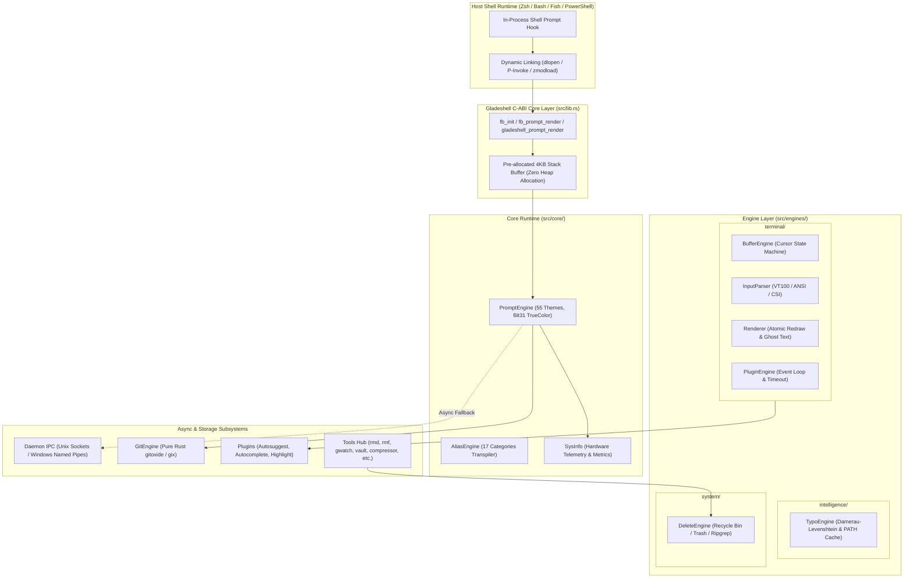

# 📖 Gladeshell Developer & Architecture Manual

Welcome to the internal engineering and architectural documentation for **Gladeshell**. This manual is designed for core maintainers, systems engineers, and open-source contributors who build, debug, and extend Gladeshell's 100% native Rust engine.

---

## 🏛️ System Architecture Overview

Gladeshell operates as a hybrid **C-ABI Dynamic Library (`cdylib`)** and a high-performance **CLI Binary (`bin`)**. In-process shell hooks dynamically load the library directly into shell memory (Zsh, Bash, Fish, PowerShell) to achieve sub-millisecond, zero-fork prompt rendering.

---

## 📚 Architectural Guides

| Guide | Description | Key Source Locations |
| :--- | :--- | :--- |
| [**C-ABI & Shell Hooks**](file:///home/rihad/Developer/archive/creative-educational-code/gladeshell/docs/architecture/c_abi_and_shell_hooks.md) | In-process dynamic loading, P/Invoke, `dlopen`, memory contracts | `src/lib.rs`, `src/init/` |
| [**Memory Model & Allocator**](file:///home/rihad/Developer/archive/creative-educational-code/gladeshell/docs/architecture/memory_model.md) | Zero-allocation hot path, `mimalloc`, stack buffers, panic strategy | `src/lib.rs`, `Cargo.toml` |
| [**Feature Flags Matrix**](file:///home/rihad/Developer/archive/creative-educational-code/gladeshell/docs/architecture/feature_flags.md) | Minimal core (`--no-default-features`) vs `tools` vs `prompt-engine` | `Cargo.toml`, `src/engines/mod.rs` |
| [**Terminal Engine Subsystem**](file:///home/rihad/Developer/archive/creative-educational-code/gladeshell/docs/engines/terminal_engine.md) | Buffer state machine, VT100 key parser, atomic redraw, plugin loop | `src/engines/terminal/` |
| [**Intelligence Engine Subsystem**](file:///home/rihad/Developer/archive/creative-educational-code/gladeshell/docs/engines/intelligence_engine.md) | Damerau-Levenshtein distance, 24h disk cache, typo suggestions | `src/engines/intelligence/` |
| [**System Engine Subsystem**](file:///home/rihad/Developer/archive/creative-educational-code/gladeshell/docs/engines/system_engine.md) | Windows Recycle Bin, macOS Trash, Linux XDG, Ripgrep walker | `src/engines/system/` |
| [**Prompt Engine & 55 Themes**](file:///home/rihad/Developer/archive/creative-educational-code/gladeshell/docs/core/prompt_engine.md) | Bit 31 TrueColor packing, transient prompts, sub-100µs latency | `src/core/prompt.rs` |
| [**Aliases Engine**](file:///home/rihad/Developer/archive/creative-educational-code/gladeshell/docs/core/aliases_engine.md) | Centralized TOML alias registry, 17 categories, shell transpilation | `src/core/aliases/` |
| [**SysInfo & Hardware Telemetry**](file:///home/rihad/Developer/archive/creative-educational-code/gladeshell/docs/core/sysinfo_and_diagnostics.md) | CPU load/temp, RAM, Starship battery, duration benchmarks | `src/core/sysinfo.rs` |
| [**Daemon & IPC Protocol**](file:///home/rihad/Developer/archive/creative-educational-code/gladeshell/docs/daemon/ipc_protocol.md) | Unix domain sockets, Named Pipes, asynchronous prompt pre-render | `src/daemon/` |
| [**Gitoxide Pure-Rust Engine**](file:///home/rihad/Developer/archive/creative-educational-code/gladeshell/docs/git/gitoxide_integration.md) | In-process git state (branch, dirty, stash count) without `git` fork | `src/git/` |
| [**Productivity Plugins**](file:///home/rihad/Developer/archive/creative-educational-code/gladeshell/docs/plugins/productivity_plugins.md) | Autosuggest history lookup, Trie autocomplete, syntax highlight | `src/plugins/` |
| [**Deletion Explorer (`rmd`/`rmf`)**](file:///home/rihad/Developer/archive/creative-educational-code/gladeshell/docs/tools/deletion_explorer.md) | Modern interactive TUI, Ripgrep multithreaded cleanup explorer | `src/tools/rmd.rs`, `src/tools/rmf.rs` |
| [**Watcher & Hot-Reload (`gwatch`)**](file:///home/rihad/Developer/archive/creative-educational-code/gladeshell/docs/tools/watcher_supervisor.md) | Zero-overhead inotify supervisor, Rust/C++/Go/Python/Node/Zig | `src/tools/gwatch.rs` |
| [**Cryptography Vault (`vault`)**](file:///home/rihad/Developer/archive/creative-educational-code/gladeshell/docs/tools/cryptography_vault.md) | AES-256-GCM, PBKDF2 (600k rounds), Zeroize memory sanitization | `src/tools/vault.rs` |
| [**Parallel Compression Suite**](file:///home/rihad/Developer/archive/creative-educational-code/gladeshell/docs/tools/compression_suite.md) | Multi-core parallel archive compression & decompression | `src/tools/compressor.rs`, `extractor.rs` |
| [**Multimedia Suite (`ffmedia`)**](file:///home/rihad/Developer/archive/creative-educational-code/gladeshell/docs/tools/multimedia_suite.md) | 24-in-1 FFmpeg audio/video suite, compressor, GIF maker, player | `src/tools/ffmedia.rs`, `video_player.rs` |
| [**Search & Navigation Suite**](file:///home/rihad/Developer/archive/creative-educational-code/gladeshell/docs/tools/search_and_navigation.md) | Interactive file finder, Ripgrep search, fuzzy cd, frecency jump | `src/tools/file_find.rs`, `fast_grep.rs`, `z_jumper.rs` |
| [**Git Productivity Utilities**](file:///home/rihad/Developer/archive/creative-educational-code/gladeshell/docs/tools/git_utilities.md) | Interactive branch manager TUI (`gbranch`), smart WIP auto-pusher (`gwip`) | `src/tools/gbranch.rs`, `git_wip.rs` |
| [**Docker Manager (`dman`)**](file:///home/rihad/Developer/archive/creative-educational-code/gladeshell/docs/tools/docker_manager.md) | Interactive container, image, and volume dashboard TUI | `src/tools/dman.rs` |
| [**Package & Runtime Installer**](file:///home/rihad/Developer/archive/creative-educational-code/gladeshell/docs/tools/package_and_runtime_installer.md) | Universal installer for Rust, Bun, Node, Go, Zig, Python, Docker | `src/tools/runtime_installer.rs`, `dep_installer.rs` |
| [**System Diagnostics & Optimizer**](file:///home/rihad/Developer/archive/creative-educational-code/gladeshell/docs/tools/system_diagnostics_and_optimizer.md) | Comprehensive hardware specs (`pc-info`), memory cache trimmer (`pc-opt`) | `src/tools/pc_info.rs`, `pc_optimizer.rs` |
| [**IDE & Editor Setup Suites**](file:///home/rihad/Developer/archive/creative-educational-code/gladeshell/docs/tools/ide_and_editor_setup.md) | Automated VS Code and Zed editor configuration & theme sync | `src/tools/code_setup.rs`, `zed_setup.rs` |
| [**Maintenance & Lifecycle**](file:///home/rihad/Developer/archive/creative-educational-code/gladeshell/docs/tools/maintenance_and_lifecycle.md) | Atomic self-upgrade, rollback guard, uninstaller, system updater | `src/tools/self_upgrade.rs`, `uninstaller.rs`, `updater.rs` |
| [**File & Content Utilities**](file:///home/rihad/Developer/archive/creative-educational-code/gladeshell/docs/tools/file_and_content_utilities.md) | Batch file renamer, auto-ls, bak, cheat-sheet, mkd, touch | `src/tools/file_renamer.rs`, `auto_ls.rs`, `keep.rs` |
| [**Project Scaffolding Suite**](file:///home/rihad/Developer/archive/creative-educational-code/gladeshell/docs/tools/project_scaffolding.md) | Project Hub, `makecpp`, `makerust`, `vite`, `next`, `tailwind` | `src/tools/project_setup/` |
| [**System Utilities & TUIs**](file:///home/rihad/Developer/archive/creative-educational-code/gladeshell/docs/tools/system_utilities.md) | `theme_picker`, `system_clean`, `pc_info`, `fkill`, `z_jumper` | `src/tools/` |

---

## 🗂️ Complete Source Code Map (All 107 Rust Files)

Below is the complete, verified inventory of all 107 Rust source files in `src/`.

| # | Source File Path | LoC | Subsystem Domain | Feature Gate | Architectural Responsibility |
| :---: | :--- | :---: | :--- | :--- | :--- |
| 1 | `src/cli.rs` | 582 | CLI & Interface | Default | Clap CLI argument parsing, flags, and subcommand schema definitions |
| 2 | `src/lib.rs` | 312 | C-ABI Core | Default | Dynamic library C-ABI exports (`fb_*`, `gladeshell_*`), module re-export shims |
| 3 | `src/main.rs` | 942 | CLI Entrypoint | Default | Fast-path binary dispatcher, typo suggestions, subcommand execution router |
| 4 | `src/core/mod.rs` | 16 | Core Module | Default | Module declarations and re-exports for the core runtime layer |
| 5 | `src/core/prompt.rs` | 2878 | Core Engine | Default | Zero-allocation prompt renderer, 55 themes, TrueColor ANSI bit-packing |
| 6 | `src/core/aliases/mod.rs` | 363 | Core Aliases | Default | Centralized cross-shell alias engine, parser, and category registry |
| 7 | `src/core/aliases/categories/mod.rs` | 50 | Core Aliases | Default | Category aggregator and dynamic candidate lookup router |
| 8 | `src/core/aliases/categories/bun.rs` | 60 | Core Aliases | Default | Bun runtime aliases (`bi`, `br`, `brd`, `bhot`, `w`) |
| 9 | `src/core/aliases/categories/developer.rs` | 132 | Core Aliases | Default | General developer tools and project workflow aliases |
| 10 | `src/core/aliases/categories/docker.rs` | 291 | Core Aliases | Default | Docker and Docker Compose container management aliases |
| 11 | `src/core/aliases/categories/editor.rs` | 78 | Core Aliases | Default | VS Code, Zed, Neovim, Nano editor invocation aliases |
| 12 | `src/core/aliases/categories/git.rs` | 144 | Core Aliases | Default | Git version control shorthand aliases (`gs`, `ga`, `gcm`, `gps`) |
| 13 | `src/core/aliases/categories/maintenance.rs` | 38 | Core Aliases | Default | System maintenance and disk cleanup aliases |
| 14 | `src/core/aliases/categories/modern_cli.rs` | 92 | Core Aliases | Default | Rust CLI alternatives (eza, bat, ripgrep, fd, dust) aliases |
| 15 | `src/core/aliases/categories/navigation.rs` | 78 | Core Aliases | Default | Directory movement shortcuts (`..`, `...`, `dev`, `fr`, `ba`) |
| 16 | `src/core/aliases/categories/npm.rs` | 54 | Core Aliases | Default | Node Package Manager shortcuts (`ni`, `nid`, `nr`, `nrd`) |
| 17 | `src/core/aliases/categories/pnpm_yarn.rs` | 48 | Core Aliases | Default | Pnpm and Yarn modern package manager aliases |
| 18 | `src/core/aliases/categories/postgres.rs` | 126 | Core Aliases | Default | PostgreSQL database management and psql client shortcuts |
| 19 | `src/core/aliases/categories/prisma.rs` | 195 | Core Aliases | Default | Prisma ORM migrations, studio, and schema generation aliases |
| 20 | `src/core/aliases/categories/python.rs` | 42 | Core Aliases | Default | Python, virtual environment, and pip management aliases |
| 21 | `src/core/aliases/categories/rust.rs` | 60 | Core Aliases | Default | Cargo build, test, clippy, check, and bench shorthand aliases |
| 22 | `src/core/aliases/categories/system.rs` | 54 | Core Aliases | Default | OS-level service management and process control shortcuts |
| 23 | `src/core/aliases/categories/tools.rs` | 322 | Core Aliases | Default | Custom Gladeshell native tool wrapper commands |
| 24 | `src/core/env.rs` | 248 | Core Runtime | Default | Cross-platform environment variable and PATH sanitization logic |
| 25 | `src/core/secret_gen.rs` | 70 | Core Runtime | Default | Cryptographically secure random token and key generation |
| 26 | `src/core/sysinfo.rs` | 1248 | Core Telemetry | Default | Hardware metrics collection (CPU usage, RAM, Starship battery, duration) |
| 27 | `src/core/utils.rs` | 108 | Core Utilities | Default | Atomic file replacement, path normalization, and UNC string sanitization |
| 28 | `src/daemon/mod.rs` | 456 | IPC Daemon | Default | Background IPC daemon socket/pipe server, prompt pre-render cache |
| 29 | `src/daemon/client.rs` | 144 | IPC Client | Default | Async IPC client with automatic fallback to in-process synchronous renderer |
| 30 | `src/engines/mod.rs` | 23 | Engine Facade | Default | Central engine layer facade aggregating terminal, intelligence, and system engines |
| 31 | `src/engines/terminal/mod.rs` | 23 | Terminal Engine | Default | Subsystem module aggregator and re-exports for interactive terminal runtime |
| 32 | `src/engines/terminal/buffer.rs` | 440 | Terminal Engine | Default | Active line buffer, Unicode scalar indexing, and cursor state machine |
| 33 | `src/engines/terminal/parser.rs` | 635 | Terminal Engine | Default | Unified VT100 / ANSI / CSI / SS3 key event parser with byte lookahead |
| 34 | `src/engines/terminal/renderer.rs` | 440 | Terminal Engine | Default | Atomic double-buffered redraw engine with ghost text suggestion rendering |
| 35 | `src/engines/terminal/plugin.rs` | 331 | Terminal Engine | Default | Terminal plugin lifecycle manager, timeout guards, and event loop dispatcher |
| 36 | `src/engines/intelligence/mod.rs` | 13 | Intelligence | Default | Intelligence subsystem facade for command typo suggestion engines |
| 37 | `src/engines/intelligence/typo.rs` | 520 | Intelligence | Default | Damerau-Levenshtein distance algorithm and 24h disk-cached PATH scanner |
| 38 | `src/engines/system/mod.rs` | 15 | System Engine | `tools` | OS subsystem facade for file management and deletion engines |
| 39 | `src/engines/system/delete.rs` | 609 | System Engine | `tools` | Cross-platform safe deletion core (Recycle Bin / Trash / Ripgrep search) |
| 40 | `src/git/mod.rs` | 759 | Git Engine | `prompt-engine` | Pure Rust gitoxide (`gix`) integration (branch name, dirty status, ahead/behind) |
| 41 | `src/init/mod.rs` | 118 | Shell Init | Default | Multi-shell initialization script router and template coordinator |
| 42 | `src/init/shared.rs` | 1165 | Shell Init | Default | Shared cross-shell functions, PATH configurations, and environment scripts |
| 43 | `src/init/bash.rs` | 136 | Shell Init | Default | Bash shell startup generator, PROMPT_COMMAND hook, and alias exporter |
| 44 | `src/init/zsh.rs` | 387 | Shell Init | Default | Zsh shell startup generator, precmd hook, zmodload integration, zle bindings |
| 45 | `src/init/fish.rs` | 154 | Shell Init | Default | Fish shell event handlers, fish_prompt hook, and abbreviation generator |
| 46 | `src/init/pwsh.rs` | 217 | Shell Init | Default | PowerShell prompt function, P/Invoke dynamic bindings, and profile integration |
| 47 | `src/init/cleaner.rs` | 453 | Shell Init | Default | Shell config sanitization, dead alias removal, and installer unhooking |
| 48 | `src/plugins/mod.rs` | 10 | Plugins | Default | Module exports for terminal productivity plugins |
| 49 | `src/plugins/autocomplete.rs` | 562 | Plugins | Default | Tab-completion candidate generator for commands, filepaths, and git branches |
| 50 | `src/plugins/autosuggest.rs` | 444 | Plugins | Default | Fish-like command autosuggestion engine with prefix history matching |
| 51 | `src/plugins/highlight.rs` | 758 | Plugins | Default | Real-time syntax highlighter for executables, options, strings, and paths |
| 52 | `src/tools/mod.rs` | 59 | Tools Module | `tools` | Module declarations and re-exports for built-in developer tools |
| 53 | `src/tools/auto_ls.rs` | 335 | Tools Utility | `tools` | Post-`cd` automated directory lister with git branch and status badges |
| 54 | `src/tools/bak.rs` | 71 | Tools Utility | `tools` | Fast file and directory `.bak` backup/restore utility |
| 55 | `src/tools/bun_runner.rs` | 780 | Tools Runner | `tools` | Interactive Bun JS/TS file selector and runner with argument forwarding |
| 56 | `src/tools/code_setup.rs` | 1606 | Tools Setup | `tools` | VS Code workspace, settings, extensions, and keyboard bindings configurer |
| 57 | `src/tools/compressor.rs` | 2256 | Tools Archive | `tools` | High-performance multi-threaded parallel archiver (zip, tar.gz, 7z, zstd) |
| 58 | `src/tools/dep_installer.rs` | 210 | Tools Installer | `tools` | Automatic dependency and system package installer across Linux/macOS/Windows |
| 59 | `src/tools/dman.rs` | 1110 | Tools Docker | `tools` | Interactive Docker container and image management Ratatui TUI |
| 60 | `src/tools/drive_jumper.rs` | 67 | Tools Navigation| `tools` | Quick Windows drive and root mount jumper |
| 61 | `src/tools/extractor.rs` | 3463 | Tools Archive | `tools` | Universal multi-format parallel archive extractor with flat path extraction |
| 62 | `src/tools/fast_grep.rs` | 146 | Tools Search | `tools` | High-speed ripgrep search engine binding with colored regex matching |
| 63 | `src/tools/ffmedia.rs` | 2469 | Tools Media | `tools` | 24-in-1 FFmpeg audio/video processing suite (converter, compressor, cutter) |
| 64 | `src/tools/file_find.rs` | 1866 | Tools Search | `tools` | Interactive file finder and content searcher with live preview |
| 65 | `src/tools/file_renamer.rs` | 1365 | Tools Utility | `tools` | Bulk file renamer with regex find/replace and preview diffs |
| 66 | `src/tools/fkill.rs` | 635 | Tools Process | `tools` | Interactive process search and termination TUI with PID filtering |
| 67 | `src/tools/fuzzy_cd.rs` | 1596 | Tools Navigation| `tools` | Fuzzy directory jumper and interactive path explorer |
| 68 | `src/tools/gbranch.rs` | 858 | Tools Git | `tools` | Interactive Git branch switcher, creator, and cleaner with live log preview |
| 69 | `src/tools/git_wip.rs` | 1351 | Tools Git | `tools` | Smart Work-in-Progress (WIP) commit generator with automated push |
| 70 | `src/tools/gwatch.rs` | 2816 | Tools Supervisor| `tools` | Universal zero-overhead file watcher and dev supervisor (Rust/C++/Go/Python/Node) |
| 71 | `src/tools/history_search.rs` | 408 | Tools History | `tools` | Interactive shell history searcher with fuzzy frequency ranking |
| 72 | `src/tools/keep.rs` | 1595 | Tools Help | `tools` | Interactive command cheat-sheet and documentation reference viewer |
| 73 | `src/tools/mkd.rs` | 39 | Tools Utility | `tools` | Combined `mkdir -p` and instant `cd` utility |
| 74 | `src/tools/notes.rs` | 2414 | Tools Notes | `tools` | Local markdown notes manager, editor, and search Ratatui TUI |
| 75 | `src/tools/pc_info.rs` | 3675 | Tools Diagnostics| `tools` | Comprehensive hardware diagnostics and system info dashboard (WMI/sysfs) |
| 76 | `src/tools/pc_optimizer.rs` | 2160 | Tools Optimizer | `tools` | System memory cache trimmer, DNS flusher, and temporary file optimizer |
| 77 | `src/tools/pkg_converter.rs` | 133 | Tools Utility | `tools` | Universal package manager command converter (npm <-> bun <-> pnpm <-> yarn) |
| 78 | `src/tools/project_setup/mod.rs` | 64 | Tools Scaffolding| `tools` | Module aggregator for project initialization and framework generators |
| 79 | `src/tools/project_setup/hub.rs` | 514 | Tools Scaffolding| `tools` | Interactive project setup wizard hub (Next.js, Vite, Bun, Tailwind v4) |
| 80 | `src/tools/project_setup/html.rs` | 44 | Tools Scaffolding| `tools` | Single-page modern HTML5 boilerplate generator |
| 81 | `src/tools/project_setup/ii.rs` | 57 | Tools Scaffolding| `tools` | Interactive project initialization with auto `.gitignore` generation |
| 82 | `src/tools/project_setup/makecpp.rs` | 865 | Tools Scaffolding| `tools` | Advanced C/C++ project boilerplate generator (Makefile, clang-format, vscode) |
| 83 | `src/tools/project_setup/makerust.rs` | 682 | Tools Scaffolding| `tools` | Advanced Rust boilerplate generator (bin, lib, cli, wasm, clippy config) |
| 84 | `src/tools/project_setup/next.rs` | 31 | Tools Scaffolding| `tools` | Next.js project initializer via Bun or NPM |
| 85 | `src/tools/project_setup/shadcn_ui.rs` | 93 | Tools Scaffolding| `tools` | Shadcn/UI component library installer and initializer |
| 86 | `src/tools/project_setup/tailwind.rs` | 88 | Tools Scaffolding| `tools` | Tailwind CSS v4 setup and `@import "tailwindcss"` configurator |
| 87 | `src/tools/project_setup/utils.rs` | 213 | Tools Scaffolding| `tools` | Scaffolding path utilities and package manager execution helpers |
| 88 | `src/tools/project_setup/vite.rs` | 72 | Tools Scaffolding| `tools` | Vite frontend project initializer with React/Vue/Svelte presets |
| 89 | `src/tools/rmd.rs` | 480 | Tools Deletion | `tools` | Modern safe directory deletion (CLI, `--trash`, and interactive confirmation TUI) |
| 90 | `src/tools/rmf.rs` | 616 | Tools Deletion | `tools` | Modern safe file deletion with interactive Ripgrep cleanup explorer |
| 91 | `src/tools/runtime_installer.rs` | 2397 | Tools Installer | `tools` | Cross-platform runtime installer (Rust, Bun, Node, Go, Zig, Python, Docker) |
| 92 | `src/tools/secret_gen_tool.rs` | 35 | Tools Security | `tools` | CLI tool wrapper for cryptographically secure passwords and API keys |
| 93 | `src/tools/self_uninstall.rs` | 230 | Tools Lifecycle | `tools` | Complete clean uninstaller removing hooks, binaries, and configurations |
| 94 | `src/tools/self_upgrade.rs` | 940 | Tools Lifecycle | `tools` | In-place atomic self-upgrader with SHA256 verification and rollback guard |
| 95 | `src/tools/system_clean.rs` | 837 | Tools Cleaner | `tools` | System cache, build artifacts, and package manager cleaner TUI |
| 96 | `src/tools/system_update.rs` | 784 | Tools Updater | `tools` | Unified system updater across APT, Pacman, Homebrew, Winget, and Cargo |
| 97 | `src/tools/theme_picker.rs` | 1114 | Tools Theming | `tools` | Interactive 55-theme browser with real-time ANSI prompt preview TUI |
| 98 | `src/tools/todo.rs` | 557 | Tools Productivity| `tools` | Local terminal todo task manager TUI with priority tagging |
| 99 | `src/tools/touch_tool.rs` | 44 | Tools Utility | `tools` | Recursive file touch utility creating parent directories automatically |
| 100 | `src/tools/trash.rs` | 86 | Tools Deletion | `tools` | Quick CLI interface to system Recycle Bin / Trash |
| 101 | `src/tools/uninstaller.rs` | 1710 | Tools Management | `tools` | Interactive application uninstaller across Snap, Flatpak, Brew, and Winget |
| 102 | `src/tools/universal_clean.rs` | 1322 | Tools Cleaner | `tools` | Deep system artifact cleaner targeting node_modules, target/, and caches |
| 103 | `src/tools/updater.rs` | 1421 | Tools Updater | `tools` | Full software suite and language toolchain updater |
| 104 | `src/tools/vault.rs` | 1912 | Tools Security | `tools` | AES-256-GCM encrypted vault manager with PBKDF2 key derivation |
| 105 | `src/tools/video_player.rs` | 556 | Tools Media | `tools` | Terminal video and audio player with format auto-detection |
| 106 | `src/tools/zed_setup.rs` | 857 | Tools Setup | `tools` | Zed editor settings, keymaps, and language server configurator |
| 107 | `src/tools/z_jumper.rs` | 300 | Tools Navigation| `tools` | Frecency-based smart directory jumper with frecency score decay |
